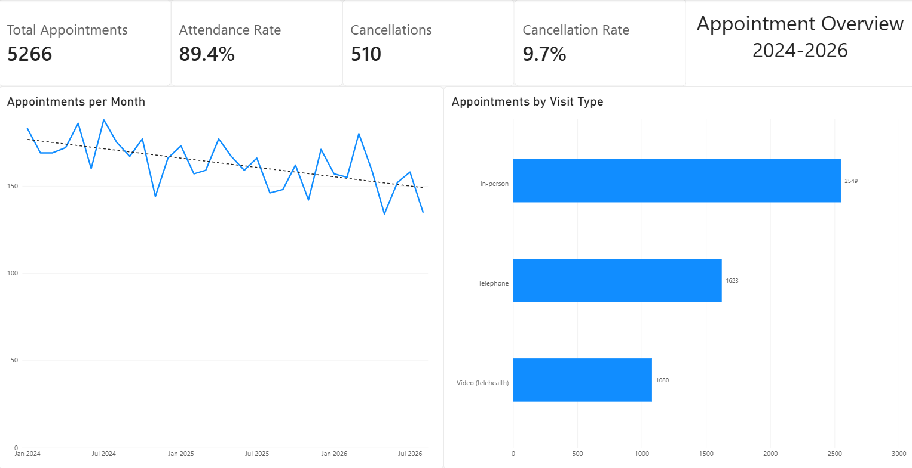
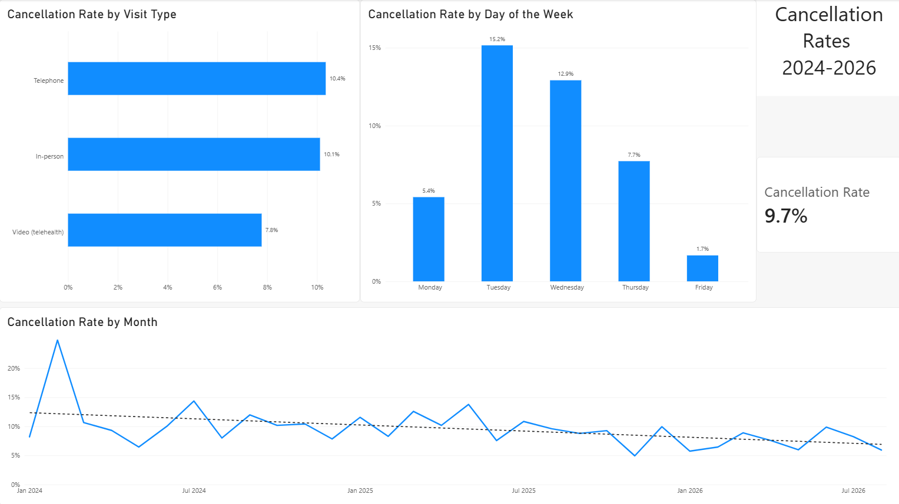

# Counseling Practice Appointment Dashboard

**Tools:** Power BI, Power Query, DAX
**Completed:** 2026, freelance project for a small outpatient counseling practice

## Overview
Every canceled appointment is an empty hour on a clinician's schedule. I built a two-page Power BI dashboard for a small counseling practice to show how many appointments they see each month and to find patterns in when and how often appointments get canceled.

## Questions
1. How many appointments does the practice see each month, and is that number changing?
2. Which visit types (in-person, telephone, video) get canceled most often?
3. Are some days of the week more likely to have cancellations than others?
4. Is the cancellation rate getting better or worse over time?

## Data
5,266 appointments from January 2024 to September 2026, exported from the practice's scheduling system and used with the owner's permission.

To protect client privacy, the data is **not** included in this repository. Before building anything, I removed all names and personal details and replaced each client with an ID number. Only totals and percentages are shown in the screenshots below, and groups with very few appointments were left out of the charts.

## Process
- **Cleaning (Power Query):** removed the total rows at the bottom of the export, checked data types, and added a **Day of Week** column, a **Day Number** column (so days sort Monday to Friday), and a **Start of Month** column for monthly charts.
- **Measures (DAX):**
  ```
  Total Appointments = COUNTROWS(appointments)
  Attended           = CALCULATE(COUNTROWS(appointments), appointments[status] = "Show")
  Attendance Rate    = DIVIDE([Attended], [Total Appointments])
  Cancellations      = CALCULATE(COUNTROWS(appointments), appointments[status] IN {"Canceled", "Late canceled"})
  Cancellation Rate  = DIVIDE([Cancellations], [Total Appointments])
  ```
- **Dashboard:** Page 1 gives an overview (KPI cards, appointments per month, appointments by visit type). Page 2 focuses on cancellations (by visit type, by day of week, and by month with a trend line).
- **Accuracy checks:** removed September 2026 from the monthly charts because the data only ran through the 10th, and started chart axes at zero so changes are not exaggerated.

## Dashboard

### Page 1: Appointment Overview


### Page 2: Cancellation Patterns


## Key Findings
- **Attendance is strong at 89.4%.** True no-shows are very rare, so cancellations are the main source of lost appointments (9.7% overall).
- **Tuesdays and Wednesdays have the most cancellations** (15.2% and 12.9%), about three times Monday's rate (5.4%).
- **Video appointments are canceled the least** (7.8%), compared to telephone (10.4%) and in-person (10.1%).
- **Cancellations are going down:** about 11% in 2024, 10% in 2025, and 7% so far in 2026. February 2024 was an unusual spike at about 25%, which the practice owner believes was caused by flu and COVID going around at the time.
- **Monthly appointment volume is slowly declining**, from about 180 per month in early 2024 to about 150 in 2026.

## Limitations
- Data comes from one small practice, so the patterns may not apply to other practices.
- The data shows *what* happened, not *why*. For example, it does not explain why Tuesdays have more cancellations, and the reason for the February 2024 spike comes from the owner rather than the data.
- Friday has far fewer appointments than other weekdays (about 180 compared to over 1,000), so its low rate is less reliable.
- No statistical tests were run, so these differences show patterns, not proven effects.

## Files
- `images/`: screenshots of both dashboard pages

The Power BI file (.pbix) is not included because it contains the underlying appointment data.
